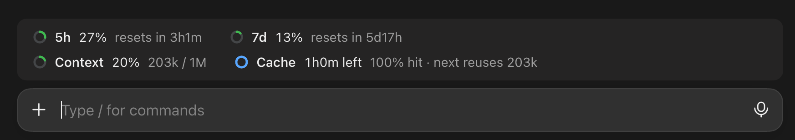

# usage-mini

A Claude Code mod that puts a small band above the prompt box.



- Shows the 5-hour and 7-day plan limits, the context fill, and the prompt cache state.
- Cold-cache guard: when the prompt cache is cold (no reply for 1 hour) and the context is 50k tokens or more, the mod holds your prompt before it goes out. Resending a large cold context costs much more than a warm one.
- The band then gives you four choices:
  - **Compact & send**: compact the session with your prompt in mind, then send the prompt.
  - **Edit compact prompt**: put a `/compact` line in the box so you can change it. The held prompt goes out after the compaction.
  - **Send anyway**: send the prompt now. The box is cleared.
  - **Cancel**: drop the hold.

## Install

At the prompt of a Claude Code terminal session:

```
/plugin install usage-mini --marketplace manssorr/claude-usage-mini-mod
```

Answer `y` to add the marketplace, then press Enter to pick the user scope.

From a shell:

```bash
claude plugin install usage-mini --marketplace manssorr/claude-usage-mini-mod
```

In the Claude desktop app, where `/plugin` does not run: click **+** next to the prompt box, then **Plugins**, **Add marketplace** with `manssorr/claude-usage-mini-mod`, then **Add plugin**.

## Test

```bash
claude plugin test .
```
